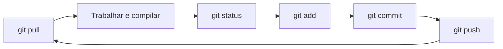

<h1 align="center">🎮 JogoTecProg</h1>

<p align="center">
  Jogo de plataforma 2D em <b>C++03</b> com <b>SFML</b><br>
  Técnicas de Programação · UTFPR Curitiba
</p>

<p align="center">
  
  
  
  
</p>


---

## 📑 Sumário

- 🗂️ [Estrutura](#estrutura)
- 🔧 [1. Instalação](#1-instalação)
- 🚀 [2. Primeira compilação](#2-primeira-compilação)
- 🔁 [3. Dia a dia](#3-dia-a-dia)
- 🌿 [4. Rotina com Git](#4-rotina-com-git)
- 🩺 [5. Problemas comuns](#5-problemas-comuns)

---

## Estrutura

```text
JogoTecProg/
├── .vscode/           # Configurações do VS Code (versionadas)
├── Classes/           # Arquivos .h
├── src/               # Arquivos .cpp
├── main.cpp
├── CMakeLists.txt     # O que construir
└── CMakePresets.json  # Como configurar (Ninja, g++, Debug)
```

> [!NOTE]
> A pasta `build/` é gerada em cada computador e **não** vai para o Git.

---

## 1. Instalação

Uma vez por computador.

**1. MSYS2.** Instale o [MSYS2](https://www.msys2.org). Descubra seu ambiente com `where.exe g++` no PowerShell: `...\ucrt64\bin` é **UCRT64** e `...\mingw64\bin` é **MINGW64**.

**2. Pacotes.** No **terminal do MSYS2** (não no cmd), conforme o seu ambiente:

```bash
# UCRT64
pacman -S mingw-w64-ucrt-x86_64-gcc mingw-w64-ucrt-x86_64-gdb mingw-w64-ucrt-x86_64-cmake mingw-w64-ucrt-x86_64-ninja

# MINGW64
pacman -S mingw-w64-x86_64-gcc mingw-w64-x86_64-gdb mingw-w64-x86_64-cmake mingw-w64-x86_64-ninja
```

> [!WARNING]
> **Não instale o pacote `sfml` do MSYS2:** ele é a versão 3, que exige C++17. O projeto baixa e compila o SFML 2.6.1 sozinho.

**3. PATH.** Adicione ao `PATH` do Windows a pasta `bin` do seu ambiente (`C:\msys64\ucrt64\bin` ou `C:\msys64\mingw64\bin`). Em um terminal novo, estes comandos devem responder: `g++`, `cmake`, `ninja`, `gdb` e `git` (use `--version`).

**4. VS Code.** Instale e mantenha **ativas** as extensões **C/C++** e **CMake Tools** (Microsoft). Se tiver a **C/C++ Runner**, desative-a.

---

## 2. Primeira compilação

```powershell
git clone https://github.com/chico-rzd/JogoTecProg.git
cd JogoTecProg
cmake --preset debug
cmake --build --preset debug
.\build\jogo.exe
```

> [!NOTE]
> O primeiro build **demora alguns minutos**, porque baixa e compila o SFML (precisa de internet). Os próximos são rápidos.

No VS Code, basta abrir a pasta, escolher o preset **Debug (Ninja + g++)** e pressionar <kbd>F5</kbd>.

---

## 3. Dia a dia

**Fluxo:** edite, salve (<kbd>Ctrl</kbd>+<kbd>S</kbd>) e pressione <kbd>F5</kbd>. Ele compila e abre o jogo no depurador. Erros de compilação aparecem no painel **Problems**.

| Atalho | Ação |
|---|---|
| <kbd>F5</kbd> | Compilar e depurar |
| <kbd>Ctrl</kbd>+<kbd>F5</kbd> | Executar sem depurar |
| <kbd>Ctrl</kbd>+<kbd>Shift</kbd>+<kbd>B</kbd> | Só compilar |
| <kbd>Shift</kbd>+<kbd>F5</kbd> | Parar |
| <kbd>F9</kbd> | Breakpoint na linha |
| <kbd>F10</kbd> / <kbd>F11</kbd> | Executar a linha / entrar na função |

**Pelo terminal** (na raiz do projeto):

```powershell
cmake --build --preset debug     # compilar
.\build\jogo.exe                 # executar
```

| Situação | Ação |
|---|---|
| `.cpp` novo em `src/` | Só compilar |
| `.h` novo em `Classes/` | Nada |
| Mudou `CMakeLists.txt` ou o preset | Reconfigurar: `cmake --preset debug` |

> [!IMPORTANT]
> O código é **C++03**: sem `auto`, `nullptr`, `override` ou `range-for`.

> [!TIP]
> Evite apagar `build/`: o SFML baixado fica dentro dele e teria de ser compilado de novo.

---

## 4. Rotina com Git



---

## 5. Problemas comuns

| Sintoma | Causa provável |
|---|---|
| `nmake ... no such file or directory` | CMake sem preset. Rode `cmake --preset debug`. |
| `ninja`, `gdb` ou `g++` não encontrado | Não instalado, ou `PATH` sem a pasta do MSYS2. |
| `pacman` não reconhecido | Você está no cmd. Use o terminal MSYS2. |
| *"The debug type is not recognized"* | Extensão **C/C++** (Microsoft) desativada. |
| F5 não abre o jogo | Build falhou. Veja o painel Problems. |
| Erro ao baixar o SFML | Sem internet, ou `git` não instalado. |
