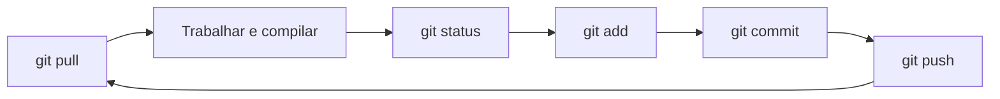

<div align="center">

# 🎮 JogoTecProg

**Jogo de plataforma em C++03 com SFML**

Trabalho em dupla · Técnicas de Programação · UTFPR Curitiba


</div>

---

## 📑 Sumário

- [Estrutura do projeto](#estrutura-do-projeto)
- [1. 🧰 Instalação](#1-instalação)
- [2. 🚀 Primeira compilação](#2-primeira-compilação)
- [3. ⚙️ Como o build funciona](#3-como-o-build-funciona)
- [4. 🔁 Compilar, executar e depurar no dia a dia](#4-compilar-executar-e-depurar-no-dia-a-dia)
- [5. 🧩 Configuração do VS Code](#5-configuração-do-vs-code)
- [6. 🌿 Rotina com Git](#6-rotina-com-git)
- [7. 🩺 Problemas comuns](#7-problemas-comuns)

---

## Estrutura do projeto

```
JogoTecProg/
├── .vscode/
│   ├── extensions.json   # Extensões recomendadas
│   ├── settings.json     # Configurações do projeto (sem caminhos pessoais)
│   ├── tasks.json        # Tarefas: configurar e compilar
│   └── launch.json       # Depuração com F5
├── Classes/              # Arquivos .h
├── src/                  # Arquivos .cpp
├── main.cpp              # Ponto de entrada
├── CMakeLists.txt        # O que construir (fontes, SFML, C++03)
├── CMakePresets.json     # Como configurar (Ninja, g++, Debug)
├── .gitignore
├── LICENSE
└── README.md
```

> [!NOTE]
> A pasta `build/` é gerada na sua máquina e **nunca** vai para o Git.

---

## 1. Instalação

Faça uma vez por computador.

### 1.1 MSYS2

Instale o [MSYS2](https://www.msys2.org) e descubra qual ambiente você usa com `where.exe g++` no PowerShell:

| Caminho do g++ | Ambiente |
|---|---|
| `C:\msys64\ucrt64\bin` | **UCRT64** |
| `C:\msys64\mingw64\bin` | **MINGW64** |

### 1.2 Pacotes

Rode no **terminal do MSYS2** (não no cmd), conforme o seu ambiente:

**UCRT64**

```
pacman -S mingw-w64-ucrt-x86_64-gcc mingw-w64-ucrt-x86_64-gdb mingw-w64-ucrt-x86_64-cmake mingw-w64-ucrt-x86_64-ninja
```

**MINGW64**

```
pacman -S mingw-w64-x86_64-gcc mingw-w64-x86_64-gdb mingw-w64-x86_64-cmake mingw-w64-x86_64-ninja
```

> [!WARNING]
> **Não** instale o pacote `sfml` do MSYS2. Ele é a versão 3, que exige C++17. O projeto baixa e compila o SFML 2.6.1 sozinho.

### 1.3 PATH do Windows

Adicione a pasta `bin` do seu ambiente (`C:\msys64\ucrt64\bin` ou `C:\msys64\mingw64\bin`) ao `PATH`. Abra um terminal **novo** e confira:

```
g++ --version
cmake --version
ninja --version
gdb --version
git --version
```

Os cinco comandos precisam responder. O `git` pode ser o [Git para Windows](https://git-scm.com).

### 1.4 VS Code

Instale as extensões **C/C++** (Microsoft) e **CMake Tools** (Microsoft). Ao abrir o projeto, o VS Code sugere as extensões listadas em `.vscode/extensions.json`.

> [!IMPORTANT]
> A extensão **C/C++** da Microsoft precisa estar **ativa**: é ela que fornece o depurador. Já a extensão **C/C++ Runner**, se estiver instalada, deve ficar **desativada**, porque concorre com o CMake Tools.

---

## 2. Primeira compilação

```
git clone <URL-DO-REPOSITORIO>
cd JogoTecProg
cmake --preset debug
cmake --build --preset debug
.\build\jogo.exe
```

> [!TIP]
> O primeiro build **demora alguns minutos**: o CMake baixa e compila o SFML (precisa de internet). Os próximos são rápidos.

No VS Code: abra a pasta do projeto, escolha o preset **Debug (Ninja + g++)** quando o CMake Tools pedir e pressione <kbd>F5</kbd>.

---

## 3. Como o build funciona

| Arquivo / ferramenta | Papel |
|---|---|
| `CMakePresets.json` | **Como** configurar: gerador Ninja, compilador `g++`, tipo Debug, pasta `build/` |
| `CMakeLists.txt` | **O que** construir: fontes, SFML, C++03, caminhos de `#include` |
| **CMake** | Lê os dois arquivos e gera o plano de compilação |
| **Ninja** | Executa o plano e só recompila o que mudou |
| **g++** | Compila os `.cpp` e liga o executável |

O processo tem duas fases:

1. **Configurar** (`cmake --preset debug`): lê o `CMakeLists.txt`, procura o compilador e baixa o SFML. Só se repete quando o `CMakeLists.txt` ou o preset mudam.
2. **Compilar** (`cmake --build --preset debug`): compila os `.cpp` modificados e gera `build/jogo.exe`. É o que se faz a cada alteração no código.

O SFML baixado fica em `build/_deps`. **Apagar `build/` obriga a baixar e compilar o SFML de novo**, então só faça isso quando for realmente necessário.

| Situação | O que fazer |
|---|---|
| Criei um `.cpp` novo em `src/` | Só compilar. O CMake o reconhece sozinho. |
| Criei um `.h` novo em `Classes/` | Nada. Basta dar `#include "Nome.h"`. |
| Mudei o `CMakeLists.txt` ou o preset | Reconfigurar (o VS Code faz isso ao salvar). |
| Erros estranhos de configuração | Em último caso, apagar `build/` e refazer. |

Os `#include` dos nossos arquivos usam só o nome (`#include "Ente.h"`), porque `Classes/` está no caminho de busca. Se criarem subpastas dentro de `Classes/`, será preciso ajustar o `target_include_directories` ou usar o caminho relativo no `#include`.

> [!NOTE]
> O código segue **C++03**: sem `auto`, `nullptr`, `override`, `range-for` e afins.

---

## 4. Compilar, executar e depurar no dia a dia

### 4.1 Fluxo recomendado no VS Code

1. Edite e salve o código (<kbd>Ctrl</kbd>+<kbd>S</kbd>).
2. Pressione <kbd>F5</kbd>: o VS Code compila (se houver mudanças) e abre o jogo sob o depurador. Se a compilação falhar, os erros aparecem no painel **Problems**, e basta clicar neles para ir à linha.
3. Para só jogar, sem depurar: <kbd>Ctrl</kbd>+<kbd>F5</kbd>.

### 4.2 Atalhos úteis

| Atalho | Ação |
|---|---|
| <kbd>Ctrl</kbd>+<kbd>S</kbd> | Salvar |
| <kbd>Ctrl</kbd>+<kbd>Shift</kbd>+<kbd>B</kbd> | Compilar (tarefa padrão de build) |
| <kbd>F5</kbd> | Compilar e depurar |
| <kbd>Ctrl</kbd>+<kbd>F5</kbd> | Compilar e executar sem depurar |
| <kbd>Shift</kbd>+<kbd>F5</kbd> | Parar a depuração |
| <kbd>Ctrl</kbd>+<kbd>Shift</kbd>+<kbd>F5</kbd> | Reiniciar a depuração |
| <kbd>F9</kbd> | Colocar ou tirar um *breakpoint* na linha |
| <kbd>F10</kbd> | Executar a linha (sem entrar em funções) |
| <kbd>F11</kbd> | Entrar na função da linha |
| <kbd>Shift</kbd>+<kbd>F11</kbd> | Sair da função atual |
| <kbd>Ctrl</kbd>+<kbd>Shift</kbd>+<kbd>P</kbd> | Paleta de comandos (digite `CMake` para ver as opções) |
| <kbd>Ctrl</kbd>+<kbd>Shift</kbd>+<kbd>M</kbd> | Abrir o painel de erros (Problems) |
| <kbd>Ctrl</kbd>+<kbd>`</kbd> | Abrir ou fechar o terminal |

> [!TIP]
> O CMake Tools também tem atalhos próprios. Para ver os que existem na sua instalação, abra <kbd>Ctrl</kbd>+<kbd>K</kbd> <kbd>Ctrl</kbd>+<kbd>S</kbd> e pesquise por `cmake`.

### 4.3 Depurando

1. Clique à esquerda do número de uma linha (ou use <kbd>F9</kbd>) para colocar um ponto vermelho, o *breakpoint*.
2. Pressione <kbd>F5</kbd>. A execução para na linha marcada.
3. Observe o painel **Run and Debug** (<kbd>Ctrl</kbd>+<kbd>Shift</kbd>+<kbd>D</kbd>):
   - **Variables**: valores das variáveis locais e dos atributos do objeto (`this`);
   - **Watch**: expressões que você quer acompanhar;
   - **Call Stack**: quem chamou quem até chegar ali.
4. Avance com <kbd>F10</kbd> e <kbd>F11</kbd>, ou continue até o próximo breakpoint com <kbd>F5</kbd>.

O que for impresso com `std::cout` aparece na aba **Debug Console**.

### 4.4 Pelo terminal

Na pasta do projeto:

| Objetivo | Comando |
|---|---|
| Configurar | `cmake --preset debug` |
| Compilar | `cmake --build --preset debug` |
| Executar | `.\build\jogo.exe` |
| Ver os comandos completos do compilador | `cmake --build --preset debug --verbose` |
| Limpar os objetos compilados | `cmake --build --preset debug --target clean` |

Compilar e executar em um comando:

```powershell
# PowerShell 7 ou cmd:
cmake --build --preset debug && .\build\jogo.exe

# Windows PowerShell 5.1 (o que vem no Windows 10):
cmake --build --preset debug; if ($?) { .\build\jogo.exe }
```

> [!IMPORTANT]
> **Sempre execute a partir da pasta raiz do projeto.** Quando o jogo carregar imagens e fontes por caminho relativo, o diretório de execução importa.

<details>
<summary><b>Depurador no terminal (opcional)</b></summary>

```
gdb .\build\jogo.exe
(gdb) break main       # para na função main
(gdb) run              # inicia
(gdb) next             # próxima linha
(gdb) print variavel   # mostra um valor
(gdb) bt               # pilha de chamadas
(gdb) quit
```

</details>

---

## 5. Configuração do VS Code

Os quatro arquivos abaixo ficam em `.vscode/` e são versionados. Eles **não podem conter caminhos do seu computador**: usam `${workspaceFolder}`, que o VS Code troca pela pasta do projeto de cada pessoa.

<details>
<summary><b><code>.vscode/extensions.json</code></b> — extensões recomendadas</summary>

```json
{
  "recommendations": [
    "ms-vscode.cpptools",
    "ms-vscode.cmake-tools"
  ]
}
```

</details>

<details>
<summary><b><code>.vscode/settings.json</code></b> — configurações do projeto</summary>

```json
{
  "cmake.useCMakePresets": "always",
  "cmake.configureOnOpen": true,
  "C_Cpp.default.configurationProvider": "ms-vscode.cmake-tools"
}
```

| Configuração | Efeito |
|---|---|
| `cmake.useCMakePresets` | Usa o `CMakePresets.json` em vez de pedir para escolher um *kit* |
| `cmake.configureOnOpen` | Configura o projeto ao abrir a pasta |
| `C_Cpp.default.configurationProvider` | O IntelliSense usa as informações do CMake, incluindo o SFML |

</details>

<details>
<summary><b><code>.vscode/tasks.json</code></b> — tarefas de configurar, compilar e executar</summary>

```json
{
  "version": "2.0.0",
  "tasks": [
    {
      "label": "Configurar (debug)",
      "type": "process",
      "command": "cmake",
      "args": ["--preset", "debug"],
      "problemMatcher": []
    },
    {
      "label": "Compilar (debug)",
      "type": "process",
      "command": "cmake",
      "args": ["--build", "--preset", "debug"],
      "group": { "kind": "build", "isDefault": true },
      "problemMatcher": ["$gcc"]
    },
    {
      "label": "Executar jogo",
      "type": "process",
      "command": "${workspaceFolder}/build/jogo.exe",
      "options": { "cwd": "${workspaceFolder}" },
      "dependsOn": "Compilar (debug)",
      "problemMatcher": []
    }
  ]
}
```

</details>

<details>
<summary><b><code>.vscode/launch.json</code></b> — depuração com F5</summary>

```json
{
  "version": "0.2.0",
  "configurations": [
    {
      "name": "Depurar jogo (gdb)",
      "type": "cppdbg",
      "request": "launch",
      "program": "${workspaceFolder}/build/jogo.exe",
      "args": [],
      "cwd": "${workspaceFolder}",
      "stopAtEntry": false,
      "externalConsole": false,
      "MIMode": "gdb",
      "miDebuggerPath": "gdb",
      "preLaunchTask": "Compilar (debug)",
      "setupCommands": [
        {
          "description": "Habilitar pretty-printing no gdb",
          "text": "-enable-pretty-printing",
          "ignoreFailures": true
        }
      ]
    }
  ]
}
```

> [!NOTE]
> O valor de `preLaunchTask` precisa ser **exatamente igual** ao `label` da tarefa em `tasks.json`.

</details>

---

## 6. Rotina com Git



---

## 7. Problemas comuns

| Sintoma | Causa provável |
|---|---|
| `nmake ... no such file or directory` | O CMake não está usando o preset. Rode `cmake --preset debug`. |
| `ninja: command not found` | Ninja não instalado ou `PATH` sem a pasta do MSYS2. |
| `pacman` não reconhecido | Você está no cmd. Abra o terminal MSYS2 (UCRT64 ou MINGW64). |
| Erro ao baixar o SFML | Sem internet, ou `git` não instalado. |
| Erros de `std::`, `nullptr` etc. | Código usando recursos acima do C++03. |
| F5 diz que a tarefa não foi encontrada | `preLaunchTask` diferente do `label` em `tasks.json`. |
| F5 diz que o programa não existe | O build falhou. Veja o painel **Problems**. |
| `gdb` não encontrado ao depurar | `gdb` não instalado ou `PATH` sem a pasta do MSYS2. |
| Avisos *debug type is not recognized* no `launch.json` | Extensão **C/C++** da Microsoft desativada ou não instalada. |
| <kbd>Ctrl</kbd>+<kbd>F5</kbd> abre um cmd vazio com um caminho de outro projeto | Uma configuração antiga (do C/C++ Runner) está selecionada. Escolha **Depurar jogo (gdb)** em Run and Debug. |
| Sublinhados vermelhos no SFML | O projeto ainda não foi configurado. Rode *CMake: Configure* e aguarde. |
